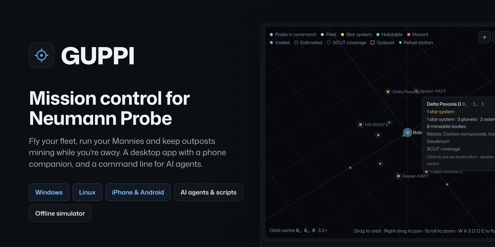
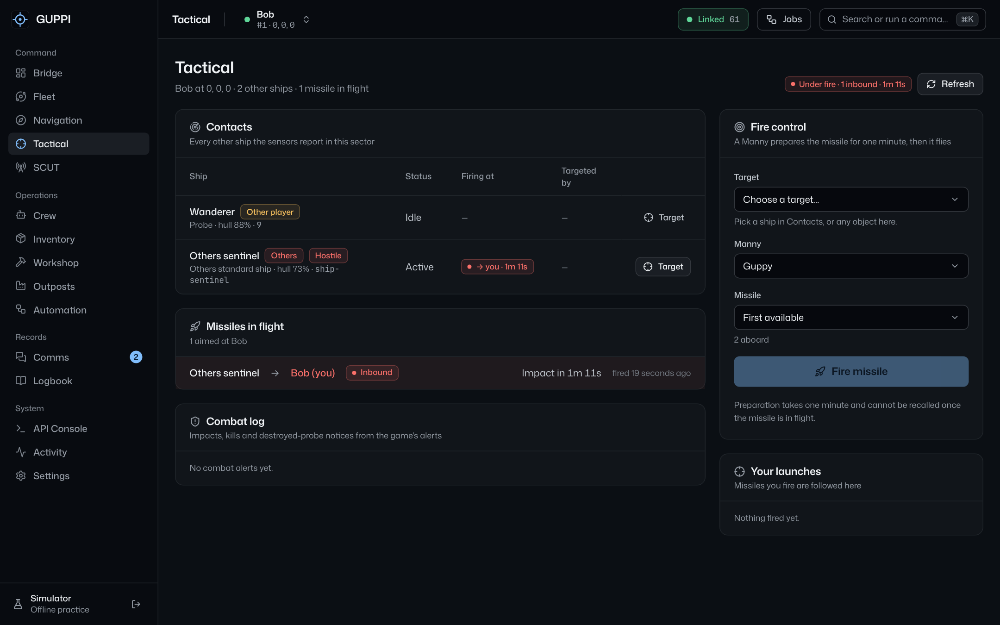
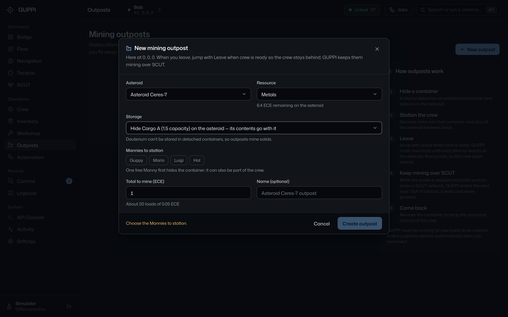
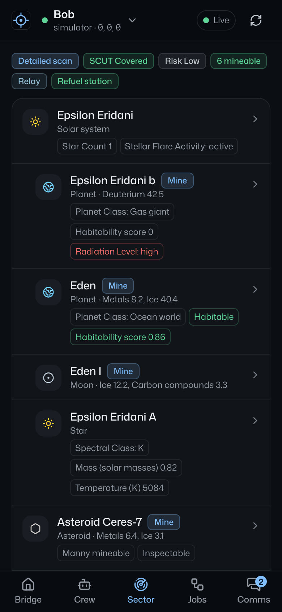

  

<h1 align="center">GUPPI</h1>

  Mission control for <a href="https://neumann-probe.net/">Neumann Probe</a>. 
  Fly your fleet, run your Mannies and keep outposts mining while you're away.

  
  
  
  
  
  

  <a href="https://github.com/Izzo2thePoint/GUPPI/releases/latest"><b>Download for Windows</b></a>
  &nbsp;·&nbsp;
  <a href="https://github.com/Izzo2thePoint/GUPPI/releases/latest"><b>Download for Linux</b></a>
  &nbsp;·&nbsp;
  <a href="#guppi-mobile-for-iphone-and-android"><b>Set up on your phone</b></a>
  &nbsp;·&nbsp;
  <a href="#for-scripts-and-ai-agents"><b>Connect an AI agent</b></a>

 

GUPPI is a free, open-source desktop companion for the browser game Neumann Probe. It talks to the game through your personal API key, shows your whole fleet as instruments rather than JSON, and runs the long, repetitive work (mining runs, craft queues, voyages, outposts) safely while you do something else. Everything it sends is checked against the game's documented API first, nothing is ever re-sent blindly, and nothing leaves your PC but the game traffic itself.

 

## Get started in three steps

1. **Download** the installer for Windows or the AppImage for Linux from the [latest release](https://github.com/Izzo2thePoint/GUPPI/releases/latest). Each release lists SHA-256 checksums so you can verify the file.
2. **Connect** with the personal API key from your Neumann Probe account, or click **Explore with the simulator** to try every screen offline first. Your key stays in the desktop process, encrypted with the OS keychain if you choose to remember it.
3. **Optional:** open **Settings → Phone & agent access** to control GUPPI from your [phone](#guppi-mobile-for-iphone-and-android), or to let a [script or AI agent](#for-scripts-and-ai-agents) fly the fleet through GUPPI's safety rails.

 

## What it does

<table>
  <tr>
    <td width="50%" valign="top">
      <h3>Bridge</h3>
      One screen for the probe in command: hull, fuel, cargo and crew as instruments, the local sector, alerts and the resources aboard. A red strip and a one-click route to Tactical when a missile is inbound.
    </td>
    <td width="50%" valign="top">
      <h3>Fleet</h3>
      Every probe at a glance, including those in transit and out of contact. Give each probe its own colours; the app wears them while you command it.
    </td>
  </tr>
  <tr>
    <td valign="top">
      <h3>Navigation</h3>
      A 3D star map of everything you know: habitable worlds, hazards, star systems, SCUT coverage, outposts and refuel stations, with every probe on it. Orbit, pan, fly and go full screen. Plan single jumps or managed voyages with a fuel reserve. Long trips fly one sector at a time, or as many per jump as you allow.
    </td>
    <td valign="top">
      <h3>Tactical</h3>
      Every other ship in the sector, who it is firing at and who is targeting it. Missiles in flight with time to impact, the ones aimed at you marked. Pick a target, a Manny and a missile, and fire.
    </td>
  </tr>
  <tr>
    <td valign="top">
      <h3>Crew and mining</h3>
      Every Manny order, with pickers filled from live data. Mining runs split any amount into cargo-sized loads across several Mannies. Refuel at stations or straight from deuterium mining.
    </td>
    <td valign="top">
      <h3>Outposts</h3>
      Hide a container on an asteroid, station a crew, and GUPPI keeps ordering loads over SCUT after you jump away. It waits for the crew to be standing at the rock before you leave, so nobody gets pulled back aboard.
    </td>
  </tr>
  <tr>
    <td valign="top">
      <h3>Workshop</h3>
      Plans what you have against what you need, down to the raw materials. Craft queues take turns on the atomic printer. <b>Build a probe</b> lists every part for a new probe or tanker and queues what is missing.
    </td>
    <td valign="top">
      <h3>Automation</h3>
      Every long job runs outside the screen with resource claims, so two automations never grab the same Manny, container or printer. Write your own routines from any documented endpoint, with waits and conditions.
    </td>
  </tr>
  <tr>
    <td valign="top">
      <h3>Phone and agents</h3>
      GUPPI Mobile for iPhone and Android, paired to your PC or standalone. A <code>guppi</code> command line, an MCP server and a local API so Claude, Cursor, Codex or your own scripts can read the fleet and give orders, with read-only and control scopes and a separate switch for dangerous actions.
    </td>
    <td valign="top">
      <h3>SCUT, comms and records</h3>
      Coverage, networks and relays. Messages, alerts and damage reports. The logbook, an API console for anything else, and an activity log of every request GUPPI made.
    </td>
  </tr>
</table>

 

## Screenshots

<table>
  <tr>
    <td width="50%"></td>
    <td width="50%"></td>
  </tr>
  <tr>
    <td align="center"><b>Bridge.</b> The probe in command as instruments.</td>
    <td align="center"><b>Fleet.</b> Every probe, each in its own colours, one in transit.</td>
  </tr>
  <tr>
    <td></td>
    <td></td>
  </tr>
  <tr>
    <td align="center"><b>Navigation.</b> The star map after a neighbour scan, with a sector readout and the helm.</td>
    <td align="center"><b>Tactical.</b> Under fire from an Others sentinel, with fire control ready.</td>
  </tr>
  <tr>
    <td></td>
    <td></td>
  </tr>
  <tr>
    <td align="center"><b>Workshop.</b> The parts list for a new probe and what the rest takes.</td>
    <td align="center"><b>Outposts.</b> Setting up a mining outpost: asteroid, container, crew.</td>
  </tr>
</table>

All screenshots are from the built-in simulator. Nothing here is sent to the game.

 

## Install

| Platform | Get it |
| --- | --- |
| **Windows** | [`GUPPI-Setup-<version>.exe`](https://github.com/Izzo2thePoint/GUPPI/releases/latest) installs with Start-menu and desktop shortcuts. [`GUPPI-Portable-<version>.exe`](https://github.com/Izzo2thePoint/GUPPI/releases/latest) runs from anywhere, no install. |
| **Linux** | [`GUPPI-<version>-x86_64.AppImage`](https://github.com/Izzo2thePoint/GUPPI/releases/latest). Run `chmod +x` on it, then open it. Needs FUSE (`sudo apt install libfuse2` on Ubuntu and Debian). |
| **iPhone or Android** | Nothing to install. See [GUPPI Mobile](#guppi-mobile-for-iphone-and-android) below. |
| **Scripts and AI agents** | [`guppi-cli-<version>.tgz`](https://github.com/Izzo2thePoint/GUPPI/releases/latest): `npm install -g` it for the `guppi` command line and the `guppi-mcp` server. See [the guide](docs/AGENT-API.md). |

**Verify a download.** Every release carries `SHA256SUMS.txt` and lists the same hashes at the end of its notes. Compare with `certutil -hashfile GUPPI-Setup-<version>.exe SHA256` on Windows or `sha256sum -c SHA256SUMS.txt` on Linux. Releases are built by GitHub Actions from the tagged commit, so what you download is what is in this repository.

> If Windows SmartScreen says "Windows protected your PC" the first time, click **More info → Run anyway**. GUPPI checks for updates only when you ask it to (Settings → Updates, or Help → Check for updates…) and never updates itself.

 

## GUPPI Mobile for iPhone and Android

<table>
  <tr>
    <td width="30%" valign="top"></td>
    <td width="30%" valign="top"></td>
    <td width="40%" valign="top">
      
A home-screen web app with the Bridge, Crew, Sector, Jobs and Comms, for iPhone and Android alike. It works two ways.

      
<b>Paired with GUPPI on your PC.</b> In GUPPI, open <b>Settings → Phone &amp; agent access</b>, switch on remote access, and point your phone's camera at the QR code. Then add it to your home screen: <b>Share → Add to Home Screen</b> in Safari on iPhone, or Chrome's menu → <b>Add to Home screen</b> on Android. The phone sends everything through GUPPI on the PC, so your key never leaves the PC, and jobs keep running there while the phone sleeps. Works on home Wi-Fi, and away from home over <a href="https://tailscale.com/">Tailscale</a>; <b>Listen on</b> can keep the server off every network but that one.

      
<b>On its own.</b> Choose <b>Direct</b> and enter your key; the phone talks to the game itself. For this the app needs an <code>https://</code> home: a free Cloudflare Worker in <a href="relay/"><code>relay/</code></a> hosts it and relays game calls in one step, or GitHub Pages can serve it. Only type your key into a copy of GUPPI Mobile that your own PC serves or that you host yourself.

      
Full details are in the <a href="guppi2/README.md#guppi-mobile-iphone-and-android">GUPPI 2 README</a>.

    </td>
  </tr>
</table>

 

## For scripts and AI agents

GUPPI doesn't build an AI in; it gives any of them a seam to plug into. Turn on **Settings → Phone & agent access**, pick a scope, and:

- **`guppi` command line:** `guppi state`, `guppi sector`, `guppi jump 4 2 0`, `guppi mine rock-1 --amount 0.2`, `guppi events --follow`, `--json` for machines. Anything that can run a shell command can run it, Claude Code and Codex included.
- **`guppi-mcp` server:** every verb as a Model Context Protocol tool for Claude Desktop, Claude Code, Cursor and other MCP clients, with read-only and destructive annotations.
- **Agent API:** the same verbs over local HTTP with an OpenAPI document and a live event stream.

Every call runs through GUPPI's own request lane below your clicks, is validated against the game's documented API, is never re-sent blindly, and appears in Activity under the agent's name. Dangerous actions (firing, jettison, assembling, detaching) stay off until you allow them. Install with `npm install -g guppi-cli-<version>.tgz` from a release. **[Read the guide →](docs/AGENT-API.md)**

 

## Built to be safe with your account

- **Your key stays in the desktop process.** The interface never sees it, responses are redacted, and the app only ever talks to `neumann-probe.net`.
- **Every request is validated first** against the game's 68 documented endpoints: paths, limits, body schemas and the sector parity rule.
- **One request lane, rate-limit aware.** User actions go first, automations second, background refreshes last. The app backs off when the game asks it to.
- **Orders are never re-sent blindly.** If the game doesn't confirm a mutation, GUPPI tells you the outcome is unknown instead of guessing.
- **Automations hold claims** on the Mannies, containers, asteroids and printer they use, so they can't collide, and they wait rather than guess when a probe is out of SCUT contact.
- **Hardened build.** The window is sandboxed with a strict Content Security Policy, every non-app request is blocked, and the shipped binary has Electron's fuses set so it cannot be made to run arbitrary Node code.

**Privacy.** GUPPI has no telemetry, no analytics and no crash reporting. It makes no network request except to the game, and to GitHub's release API only when you click **Check for updates**. Everything it keeps stays on your PC: your key (encrypted with the OS keychain, only if you tick *Remember*), the pairing token for your phone, and your settings, sector archive, bookmarks, routines and outposts in the app's local storage. **Settings → Local data** clears them. On the phone, GUPPI Mobile keeps its connection in the browser's storage when *Remember* is on; in Direct mode that includes your key, so switch it off on a shared phone. Found a hole in any of this? See [SECURITY.md](SECURITY.md).

 

## Repository

| Path | What it is |
| --- | --- |
| [`guppi2/`](guppi2/) | **GUPPI 2**, the app: Electron, React, TypeScript. Start with its [README](guppi2/README.md) and [design system](guppi2/DESIGN.md). |
| [`guppi2/cli/`](guppi2/cli/) | The `guppi` command line and `guppi-mcp` server for scripts and AI agents ([guide](docs/AGENT-API.md)) |
| [`relay/`](relay/) | Optional Cloudflare Worker that hosts GUPPI Mobile and relays game calls |
| [`docs/`](docs/) | [Release notes](docs/RELEASE-NOTES.md), the [agent guide](docs/AGENT-API.md), the [design review](docs/GUPPI-2-ANALYSIS.md) that shaped GUPPI 2, screenshots and artwork |
| [`legacy/guppi-1.16/`](legacy/guppi-1.16/) | GUPPI 1.16, the original app, kept unchanged for reference |
| [`.github/workflows/`](.github/workflows/) | Tests, builds and publishes releases with checksums; publishes the mobile web app |

**Contributing.** See [CONTRIBUTING.md](CONTRIBUTING.md). In short: run `pnpm install`, `pnpm dev` and `pnpm test` in `guppi2/`; the pre-push gate is `pnpm typecheck && pnpm test && pnpm build`, which is exactly what CI runs. Merging to `main` with a new `version` in `guppi2/package.json` publishes a GitHub Release automatically. Bugs and ideas are welcome in [Issues](https://github.com/Izzo2thePoint/GUPPI/issues/new/choose); a raw response from the API Console makes a sensor or mining bug much easier to fix. Security problems go through [SECURITY.md](SECURITY.md). Everyone taking part is asked to follow the [code of conduct](CODE_OF_CONDUCT.md).

 

GUPPI is free software under the <a href="LICENSE">MIT licence</a>. It is an independent, fan-made companion and isn't affiliated with neumann-probe.net. Game rules and API availability are controlled by Neumann Probe.
