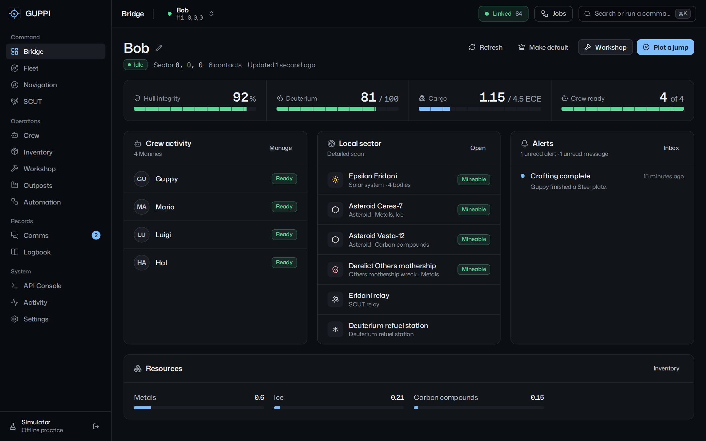
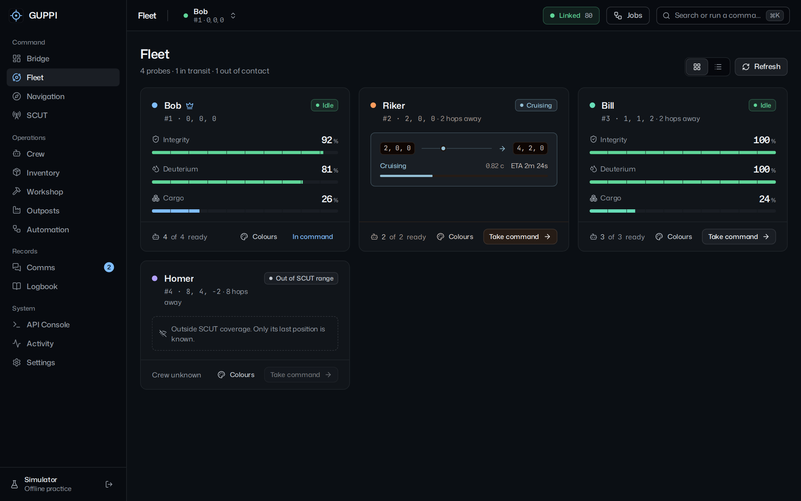
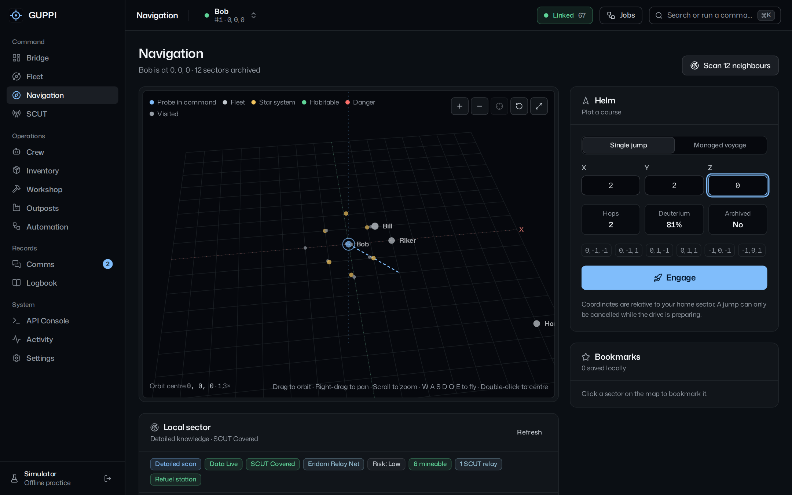
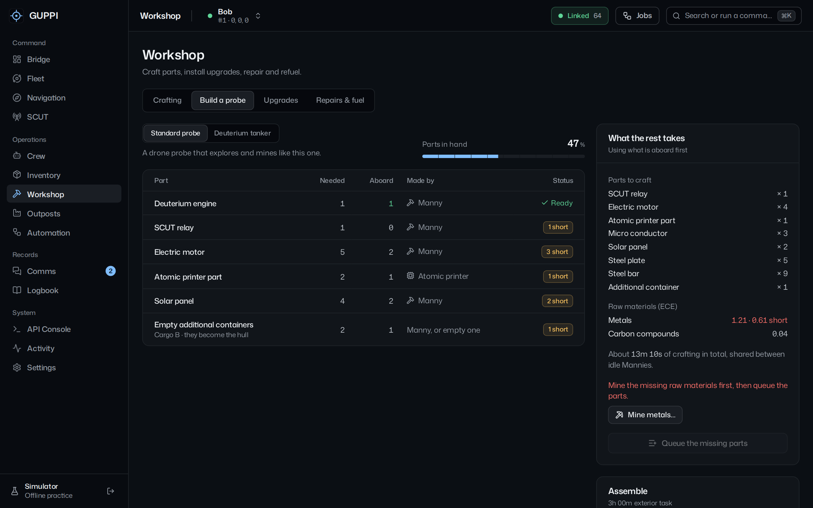
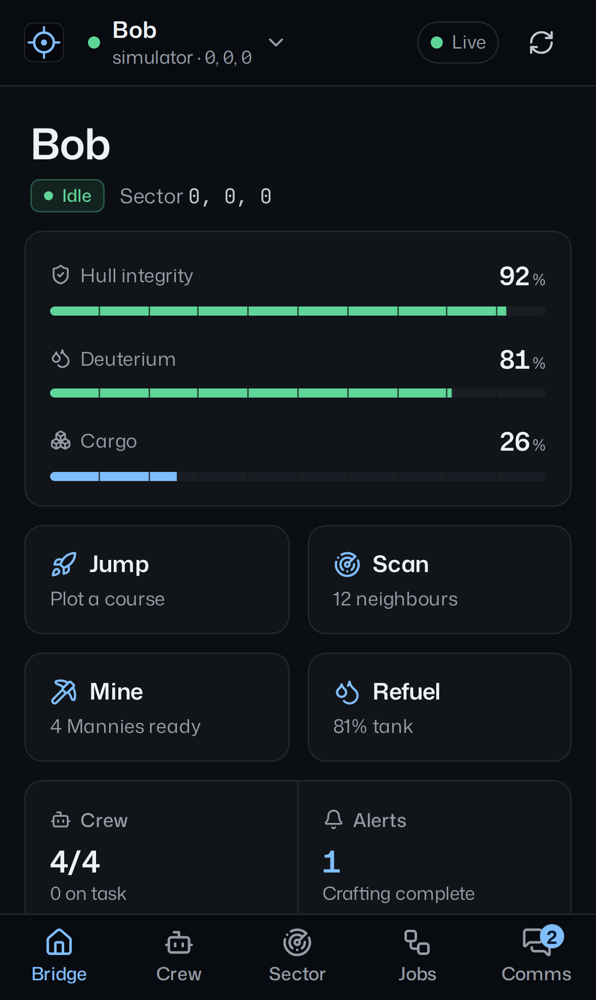

# GUPPI

Mission control for [Neumann Probe](https://neumann-probe.net/). GUPPI is a desktop app for Windows and Linux, with an iPhone companion, that flies your fleet, runs your Mannies, and keeps outposts mining while you're away. It drives the game through your personal API key.

**[Download the latest release →](https://github.com/Izzo2thePoint/GUPPI/releases/latest)**

## What it does

- **Fleet.** Every probe at a glance. Each probe can wear its own colours, and the app takes on those colours while you're in command of it.
- **Navigation.** A 3D star map you can orbit, pan, zoom and fly through with the keyboard. It includes a jump planner, managed voyages with a fuel reserve, 12-sector sweeps and bookmarks.
- **Crew and mining.** Every Manny order. Mining runs split loads to fit cargo, and outposts keep mining over SCUT after you jump away. The crew waits at the asteroid before you leave, so nobody gets pulled back aboard.
- **Workshop.** Plans what you have against what you need. Queues wait their turn for the atomic printer, and **Build a probe** lists every part for a new probe or deuterium tanker and what it takes to make the rest.
- **Safe by design.** One request lane for everything, rate-limit aware. Orders are never re-sent blindly, and every request is checked against the documented API first.
- **GUPPI Mobile.** An iPhone home-screen app. Pair it with GUPPI on your PC by QR code, or use it on its own.
- **Offline simulator.** Try everything without touching the game.

| | |
| --- | --- |
|  |  |
|  |  |

## Install

| Platform | Download |
| --- | --- |
| Windows | `GUPPI-Setup-<version>.exe` (installer) or `GUPPI-Portable-<version>.exe` |
| Linux | `GUPPI-<version>-x86_64.AppImage` (`chmod +x`, then run it) |
| iPhone | In GUPPI on your PC, open **Settings → Phone remote**, switch it on and scan the QR code. Then tap **Share → Add to Home Screen** in Safari. |

The builds aren't code-signed yet, so Windows SmartScreen may warn you. Click **More info → Run anyway**. Connect with the personal API key from your game account, or pick **Explore with the simulator**.

## Repository

| Path | What it is |
| --- | --- |
| [`guppi2/`](guppi2/) | **GUPPI 2**, the app (Electron, React, TypeScript). Start with its [README](guppi2/README.md), then its [design system](guppi2/DESIGN.md). |
| [`relay/`](relay/) | Optional Cloudflare Worker for using GUPPI Mobile without your PC |
| [`docs/`](docs/) | [Release notes](docs/RELEASE-NOTES.md), the [design review](docs/GUPPI-2-ANALYSIS.md) that shaped GUPPI 2, and screenshots |
| [`legacy/guppi-1.16/`](legacy/guppi-1.16/) | GUPPI 1.16, the original app, kept unchanged for reference |
| [`.github/workflows/`](.github/workflows/) | Builds, tests and publishes releases, plus the mobile web app |

Merging to `main` with a new `version` in `guppi2/package.json` publishes a GitHub Release automatically. See [`guppi2/README.md`](guppi2/README.md#publishing-a-release).

GUPPI is an independent, fan-made companion and isn't affiliated with neumann-probe.net. Game rules and API availability are controlled by Neumann Probe. Character artwork and third-party assets aren't represented as this project's original work.
